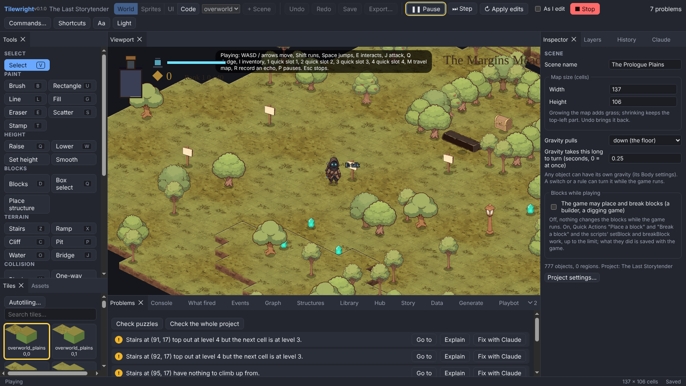
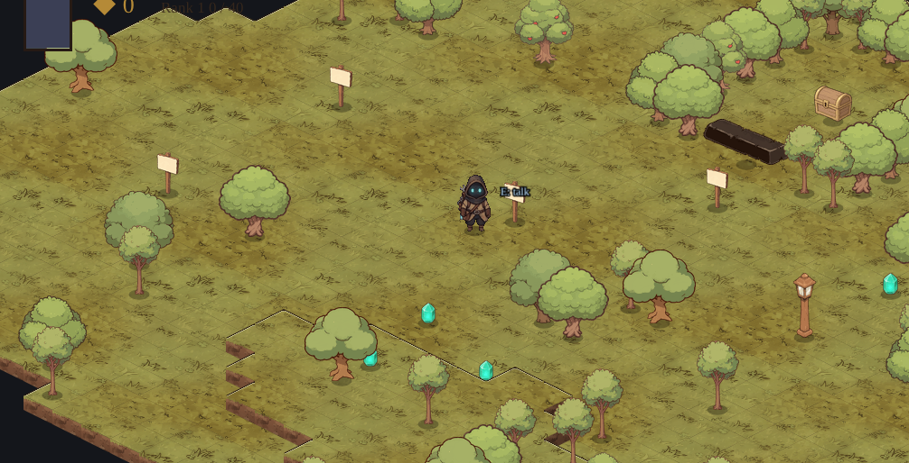

# Tilewright

**Make isometric games without writing code.** Tilewright is a free, open-source game engine and editor for 2D isometric games: paint a world out of blocks, drop in characters and props, wire up what they do, press Play, and export a game anyone can run.



*The editor playing "The Last Storytender", a complete game made with it: tools on the left, the running game in the middle, the Inspector on the right, problems and logs below.*

> **Status:** early (v0.1.0). Windows is the main platform; it also runs on Linux. Things change quickly, and feedback is very welcome.

## What makes it different

- **Gravity in any direction.** Bodies can fall toward the floor, the ceiling or any of the four walls, turn smoothly when gravity changes, and wear a different picture for each direction. Walls become floors. ([blocks and gravity](docs/blocks-and-gravity.md))
- **No code needed, code when you want it.** Behaviours, event sheets, wires and logic graphs for everything; TypeScript scripts with breakpoints when you want more. ([logic](docs/logic.md), [code window](docs/code-window.md))
- **A whole studio in one app.** World painting with blocks, stairs, cliffs, water and bridges; a sprite studio for drawing and animating; a tile studio; a UI designer for menus, HUDs, inventories and maps; dialogue, cutscenes, sound and music.
- **Tests your game for you.** A playbot plays your levels, a project check finds problems (stairs that lead nowhere, unreachable doors), and crash reports are readable.
- **Claude inside the editor.** An optional assistant that can read your project, explain problems and make changes, always asking before anything risky. ([assistant](docs/assistant.md))
- **Export to a real program.** One button turns a game into a folder with an `.exe` that runs with no editor and no internet. ([export](docs/export.md))
- **Plugins.** Combat and AI, story and items, turn-based play, simulation, lighting and more ship as plugins, and you can write your own. ([plugins](docs/plugins/README.md))



## Get started

You need **[Node.js](https://nodejs.org) 20 or newer** and **[Git](https://git-scm.com)**.

```bash
git clone https://github.com/calebwilsonit-tech/TileWrite.git
cd TileWrite
npm ci
npm run build
npm run start -w @tilewright/editor
```

Then, on the project screen:

- **Take the tutorial:** build a small playable puzzle room (a crate, a plate and a gate) in about ten minutes, without code.
- **See a finished game:** open a copy of *The Last Storytender* and look at how it is made.
- **Engine samples:** small games in nine genres (tactics, tower defence, colony sim, roguelike, RTS, point-and-click, a gravity room and more) in [`samples/`](samples). See [samples.md](docs/samples.md).

To build the Windows installer yourself, run `npm run dist:win` (details in [BUILDING.md](docs/BUILDING.md)).

For development, `npm run dev` starts the editor with live reload. Run `npm run build` again before using **Run in a window** or **Export**, since those use the built game player.

## Documentation

Everything is in [`docs/`](docs/README.md). Good places to start:

| I want to... | Read |
| --- | --- |
| Learn the editor | [editor.md](docs/editor.md) |
| Make something specific (a lever door, a boss...) | [recipes.md](docs/recipes.md) |
| Design menus and HUDs | [ui-designer.md](docs/ui-designer.md) |
| Draw sprites and tiles | [sprite-studio.md](docs/sprite-studio.md), [tile-studio.md](docs/tile-studio.md) |
| Turn my game into a program | [export.md](docs/export.md) |
| Write a plugin | [plugins/](docs/plugins/README.md) |
| Understand how the engine works | [runtime.md](docs/runtime.md), [physics.md](docs/physics.md) |

## Project layout

| Folder | What is in it |
| --- | --- |
| `packages/runtime` | The engine: world, physics, rendering, audio, saves |
| `packages/editor` | The Electron editor and the game player used for exports |
| `packages/behaviors` | Behaviours, event blocks, scripting |
| `packages/plugins/*` | The plugins that ship with Tilewright |
| `packages/plugin-sdk`, `packages/create-tilewright-plugin` | For writing your own plugins |
| `packages/exporter`, `packages/playbot`, `packages/assistant` | Export, the playbot, the in-editor assistant |
| `samples/` | Small games made with the editor, one per genre |
| `e2e/` | End-to-end tests that drive the real editor |
| `docs/` | The documentation |

## Testing

```bash
npm test            # unit tests (vitest)
npm run typecheck
npm run test:e2e    # builds the editor, then drives it with Playwright
```

## Contributing

Bug reports, ideas and pull requests are welcome: open an issue describing what you saw or what you would like. If you made something with Tilewright, please share it.

## License

[MIT](LICENSE). You can use Tilewright for anything, including commercial games; just keep the license notice with copies of the engine's code.
